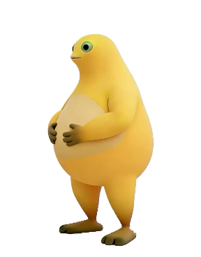
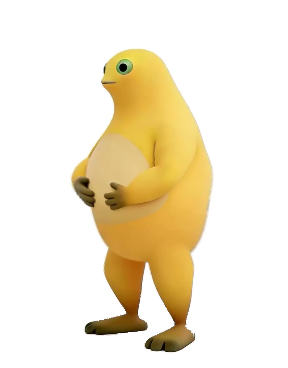

# 奶蛙桌宠 · macOS 移植版（非官方）


> 本项目是 [**yugh6/Naiwa**](https://github.com/yugh6/Naiwa) 的**非官方 macOS 移植版**。
> 原项目是一款 Windows（.NET Framework 4.x / WinForms）桌宠，版本 v1.2.2 原始素材版。
>
> 全部美术与音频素材（`素材.nwp`、`原版笑声.wav`）版权归原作者 **yugh6**
> （抖音：握石竹；抖音号：45357131546）所有。本仓库只重写了 macOS 端程序逻辑，
> 保留原作者署名与原项目地址。
>
> 原作者声明：**分享请注明作者及原项目地址，禁止搬运冒充原创；
> 如需用于短视频公开发布，请联系原作者取得许可。**

用 **Swift + AppKit** 原生重写，无第三方依赖，直接复用原项目的素材格式
（`素材.nwp` 就是 ZIP：转眼 / 眨眼 / 422 帧大笑 + metadata）。

| 待机 | 戳肚子 | 笑倒 |
| --- | --- | --- |
|  |  |  |

## 下载 / 安装

- 在 [Releases](../../releases) 下载 `Naiwa-macOS.zip`，解压后双击 `奶蛙桌宠.app`。
  Release 由 GitHub Actions 在 macOS runner 上自动构建（Apple Silicon / arm64）。
- 应用为本地 ad-hoc 签名、未经过 Apple 公证。若首次打开被 Gatekeeper 拦截：
  右键 App →「打开」，或执行
  `xattr -dr com.apple.quarantine 奶蛙桌宠.app`。
- 系统要求：macOS 11 或更高版本。

## 构建

要求：macOS 11+，Xcode Command Line Tools（`xcode-select --install`）。

```sh
./build.sh
open "dist/奶蛙桌宠.app"
```

仓库自带 `assets/`（原项目素材），构建脚本开箱即用；也可以指定其他素材目录：

```sh
NAIWA_ASSETS=/path/to/素材目录 ./build.sh
```

开发时直接跑命令行版本：

```sh
swift run Naiwa --assets assets
```

## 自动构建与发布

`.github/workflows/release.yml` 会在 GitHub Actions 的 macOS runner 上构建并测试：

- 推送到 `main`：构建 + 非阻塞自检，产物保存为 Actions Artifact。
- 推送 `v*` 标签：构建并自动创建/更新对应的 GitHub Release（附 zip 与 SHA-256）。
- 也可以在 Actions 页面手动运行 `Build macOS App`，填写要发布的标签。

```sh
git tag v1.2.2-macos
git push origin v1.2.2-macos   # 触发自动构建并发布 Release
```

## 功能对照（与 Windows 原版一致）

| 功能 | 实现 |
| --- | --- |
| 待机 / 4～8 秒随机眨眼 | 原素材眨眼 7 帧，只替换眼部 |
| 鼠标悬停转眼 | `look/00..10` 随 0.18s 缓动切换 |
| 单击肚子局部凹陷回弹 | 与 C# 逐行相同的局部网格变形（0.95s） |
| 双击捧腹大笑 14s 后躺倒 | 422 帧 @30fps，末帧停留，单击起身 |
| 拖动倾斜 + 松手轻弹 | 临界阻尼倾斜（±7°）+ 落地挤压 |
| 逐像素点击穿透 | alpha ≤ 24 的像素把事件让给下层窗口 |
| 全屏自动隐藏 | 检测前台应用窗口是否铺满奶蛙所在屏幕 |
| 右键菜单 / 菜单栏图标 | 大笑、停止/站起、声音、大小、置顶、全屏隐藏、回右下角、说明、退出 |
| 单实例 | POSIX 文件锁 + 分布式通知，重复启动回右下角 |
| 设置持久化 | `~/Library/Application Support/NaiwaDesktopPet/settings.ini` |
| 多显示器 | 支持负坐标屏幕、跨屏拖动、按屏幕限制位置 |

## 与 Windows 版的差异（平台适配）

- **菜单栏图标**：Windows 托盘单击无动作、双击回右下角、右键菜单；macOS 上为兼顾可发现性，
  单击会在双击间隔（0.4s）后弹出菜单，双击直接回右下角，右键立即弹出菜单。
- **原版笑声默认开启**：Windows 原版首次默认关闭；macOS 移植版默认开启，并在重新勾选开启时
  播放一小段试听作为反馈（下一次大笑仍从头完整播放）。
- **全屏检测**：Windows 用 `GetForegroundWindow` + DWM 边框；macOS 用
  `CGWindowListCopyWindowInfo` 检查前台应用是否有覆盖整屏（含菜单栏区域）的 layer-0 窗口。
  并用奶蛙自身窗口在窗口服务器中的几何做自校准，Mission Control 等窗口整体缩放的场景下也准确。
  普通“最大化但保留菜单栏”的窗口不会触发隐藏。
- **设置路径**：`%LOCALAPPDATA%\NaiwaDesktopPet` → `~/Library/Application Support/NaiwaDesktopPet`
  （字段名 `scale / x / y / sound / top / fullscreen` 保持不变）。
- **渲染**：用 Core Graphics 复刻 GDI+ 的变换顺序与符号（已用像素实验校验）；
  Retina 下按 backingScale 渲染，缩放依然清晰。

## 自检

原 C# 的 `--self-test` / `--demo` 也一并移植，覆盖素材完整性、动作状态机、手势判定、
全屏逻辑、窗口交互（合成鼠标事件）与渲染性能：

```sh
swift run Naiwa --self-test /tmp/naiwa-test --assets assets
```

输出 `self-test.txt`（PASS/FAIL 与耗时）以及 7 张渲染样张
（`native-idle/hover/laugh/poke/drag/blink/rest.png`）和图标文件。
当前结果：**全部 PASS**，422 帧全量解码+渲染平均约 **2.0ms/帧**（Release 构建）。

其他命令行工具：

```sh
swift run Naiwa --probe /tmp/probe.txt   # 查询正在运行的奶蛙窗口
swift run Naiwa --quit                   # 让正在运行的奶蛙退出
swift run Naiwa --demo /tmp/frames       # 渲染 720 帧交互演示 PNG
swift run Naiwa --make-icon out.icns --assets assets
```

## 目录结构

```
Sources/Naiwa/         Swift 源码
  main.swift           入口与命令行模式
  App.swift            AppDelegate、菜单栏图标、单实例与通知
  PetWindow.swift      NSWindow / 视图事件 / PetController 核心逻辑
  Motion.swift         动作状态机（眨眼、大笑、戳肚子、拖拽物理）
  Renderer.swift       软件渲染器（交叉渐隐、肚子变形、变换）
  Assets.swift         素材.nwp 载入与 LRU 帧缓存
  Zip.swift            最小 ZIP 读取（store + deflate）
  Fullscreen.swift     全屏检测、坐标自校准与防抖
  Gesture.swift        单击 / 双击 / 拖动判定
  Settings.swift       设置读写
  Icon.swift           图标生成（icns / 菜单栏图标）
  Tests.swift          自检与演示序列
assets/               原项目素材（版权归 yugh6 所有）
Resources/            Info.plist、macOS 使用说明
build.sh              构建并打包 奶蛙桌宠.app
```

## 版权与致谢

- 原桌宠项目与全部美术、音频素材：**© yugh6**，<https://github.com/yugh6/Naiwa>。
- 本仓库仅包含 macOS 端（Swift/AppKit）移植代码；未修改素材内容。
- 这不是官方版本；转载/分享请注明原作者及原项目地址，禁止冒充原创。
  用于短视频等公域传播前，请联系原作者取得许可。
